# Основы RISC-V и кросс-компиляции

Цель — научиться понимать и писать линейные последовательности машинных инструкций, освоить RARS, GNU Toolchain, QEMU и GDB.

[Подготовка окружения (на примере Mac OS с чипом M)](docs/setup.md)

[Лонгрид](docs/original.md)


## Часть 1. RISC-V и вычисления в регистрах

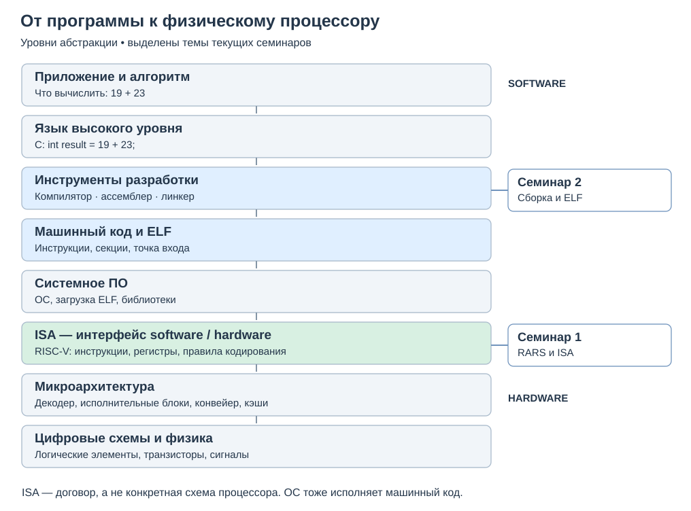

### 1. Что такое ISA

Процессор получает из памяти не текст `a+b`, а последовательность битов, которую умеет распознавать как машинную инструкцию. Например, в RISC-V машинное слово `0x006283b3` означает `add x7,x5,x6`: сложить содержимое регистров x5 и x6, записать результат в x7.

**ISA (Instruction Set Architecture)** — договор между программным обеспечением и процессором: какие команды существуют, как они кодируются, какие регистры доступны, как инструкции обращаются к памяти. 

**Микроархитектура** — как конкретное ядро реализует этот договор: конвейер, исполнительные блоки, кэш и т. д. Процессоры с одинаковой ISA могут быть устроены по-разному.

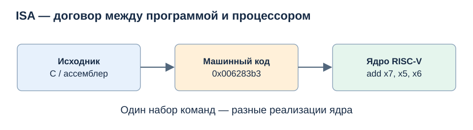

| Архитектура | Пример | Особенности для нашего курса |
|---|---|---|
| ARM64 (AArch64) | Apple M4 | 31 целочисленный регистр общего назначения, инструкции A64 по 4 байта |
| x86-64 | AMD Ryzen, Intel Core | 16 целочисленных регистров общего назначения, длина инструкции 1–15 байт |
| RV64I | RISC-V | 32 архитектурных целочисленных регистра (x0 всегда ноль), базовые инструкции по 4 байта |

RISC исторически ориентирован на сравнительно простые инструкции, удобные для компиляторов, CISC допускает более сложные инструкции и режимы адресации. В RISC-V арифметика выполняется преимущественно над регистрами; `add rd, rs1, rs2` явно задаёт три операнда. В x86 есть, например, `add rax, rbx` (результат помещается в первый операнд), а также варианты с операндом в памяти. Не стоит делать из этого вывод, что RISC всегда быстрее или экономичнее CISC: производительность и потребление зависят от реализации и нагрузки.

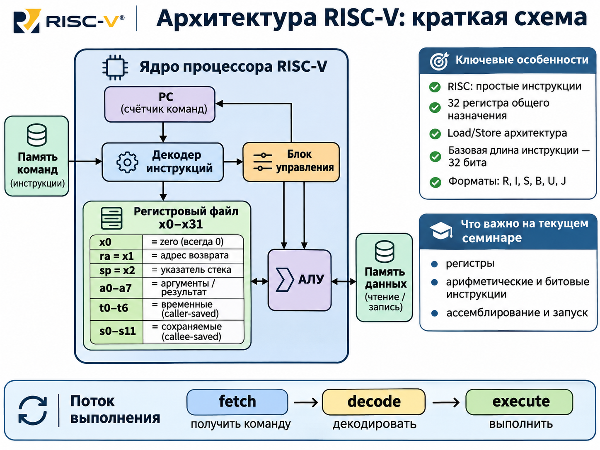

RISC-V модульна: RV32I и RV64I отличаются XLEN (32 и 64 бита); I — базовый целочисленный набор. M — умножение/деление, A — атомарные операции, F и D — single/double floating point, C — сжатые 16-битные инструкции. Например, RV64IM — 64-битные целочисленные инструкции и M. RV64G — сокращение RV64IMAFD_Zicsr_Zifencei.

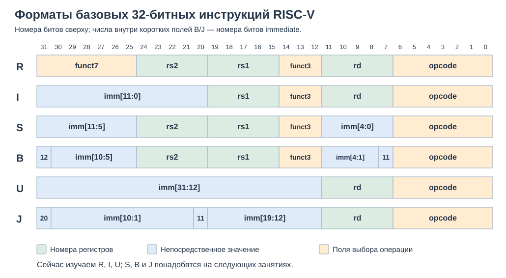

**Заметьте:** RV64 означает ширину регистра, а не длину всех инструкций и не размер всех типов C. Базовые инструкции занимают 4 байта, даже при 64-битных регистрах. Расширение C допускает 2-байтовые инструкции. RV32E/RV64E используют 16 целочисленных регистров.

### 2. Первая программа: из C в инструкции

Пусть надо вычислить `19 + 23`. В C можно написать `int result = 19 + 23;`. Компилятор мог бы сразу вычислить 42, но для понимания механики сделаем вычисление вручную: поместим числа в два регистра и выполним сложение.

Регистры — архитектурные ячейки внутри ядра, к которым обращаются инструкции. В RV64 целочисленные регистры по 64 бита. У регистров нет типа `int` или `unsigned`: смысл битов определяется инструкцией.

| Имена | Номера | Что нужно знать сейчас |
|---|---|---|
| `zero` | x0 | Всегда 0; запись не меняет его |
| `t0–t2`, `t3–t6` | x5–x7, x28–x31 | Временные значения для вычислений |
| `a0–a7` | x10–x17 | Регистры общего назначения с соглашениями для аргументов и результатов; пока просто используются в вычислениях и шаблоне вывода |
| `s0–s11` | x8–x9, x18–x27 | Соглашения о сохранении рассмотрим позже |
| `ra`, `sp`, `gp`, `tp` | x1–x4 | Специальные роли в ABI; пока не используем |

PC — отдельный счётчик команд: адрес следующей исполняемой инструкции. Он не входит в x0–x31. Пока программы линейны, после каждой базовой инструкции PC увеличивается на 4.

Откройте [rars/01_first.asm](rars/01_first.asm) и выполните действия из [инструкции RARS](docs/setup.md#первый-запуск-gui).

```asm
addi t0, zero, 19
addi t1, zero, 23
add  t2, t0, t1
```

`addi` — сложение регистра и непосредственной константы; `add` — сложение двух регистров. Первый операнд — куда записать результат; последующие — откуда брать исходные значения. Можно использовать один и тот же регистр как источник и результат, например `addi t0,t0,1`.

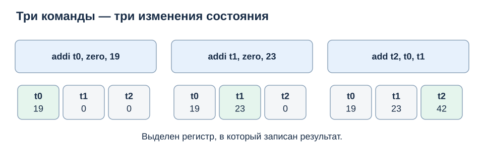

| После инструкции | t0 | t1 | t2 |
|---|---:|---:|---:|
| `addi t0,zero,19` | 19 | 0 | 0 |
| `addi t1,zero,23` | 19 | 23 | 0 |
| `add t2,t0,t1` | 19 | 23 | 42 |

В колонке Code программы RARS найдите `0x006283b3`. Формат R-инструкции состоит из полей, включая номера двух источников и назначения:

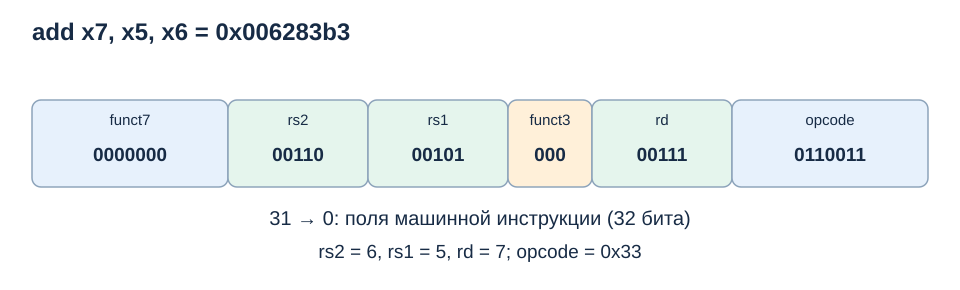

`funct7=0`, `rs2=6`, `rs1=5`, `funct3=0`, `rd=7`, `opcode=0x33`. Процессор извлекает эти поля, а не читает слова `add` или `t0`. В `Basic` может быть `add x7,x5,x6` — та же самая инструкция.

#### Что не является инструкцией процессора

- `.text` — директива ассемблера: далее описывается код.
- `.globl main` — делает имя `main` глобальным; `main:` — метка, обозначающая адрес первой инструкции. Здесь это не вызов функции.
- `# ...` — комментарий, не превращается в машинные команды.
- `mv a0,t2` — псевдоинструкция, ассемблер заменяет её на `addi a0,t2,0`.

В конце каждой программы RARS есть служебный шаблон `li a7,1; ecall; li a7,10; ecall`. Он печатает число из a0 и завершает программу. `ecall` — реальная инструкция обращения к среде выполнения; значения 1 и 10 — соглашения именно RARS, а не универсальные номера Linux. Не пытаемся пока реализовать системные вызовы самостоятельно. Не удаляйте завершающий шаблон, иначе симулятор может сообщить об уходе за конец программы.

### 3. Откуда берутся константы: реальные и псевдоинструкции

У `addi` непосредственное число занимает 12 бит со знаком, от −2048 до 2047. Поэтому команда `addi t0,zero,0x12345678` не кодируется. Ассемблер предлагает `li` (load immediate): выбирает одну или несколько инструкций для нужного числа. `li` не обращается к памяти.

[Задача 2 — большие константы](rars/02_immediates.asm).

Нужно получить `0x12345678`. Разложим число: `0x12345 × 4096 + 0x678`. Инструкция `lui` помещает 20-битное поле в биты 31:12 (нижние 12 бит нулевые, в RV64 результат знаково расширяется с 32 бит). `addi` добавляет младшую часть.

```asm
lui  t1, 0x12345   # 0x12345000
addi t1, t1, 0x678 # 0x12345678
```

Если младшая часть `0xabc`, она не помещается в положительный signed imm12. Тогда `0x12345abc = 0x12346000 − 0x544`. Используем `lui t3,0x12346` и `addi t3,t3,-1348`. В RARS сравните t0 с t1 и t2 с t3; все четыре числа должны быть попарно одинаковыми. В колонке Basic видно, на сколько реальных инструкций разворачивается `li`. Число, которое печатает пример, — 0 (разность t0 и t1). Для других 64-битных констант последовательность может быть длиннее двух инструкций.

Псевдоинструкция — это удобная для программиста запись на языке ассемблера, которой не соответствует отдельная машинная инструкция процессора.

Когда ассемблер встречает псевдоинструкцию, он заменяет её одной или несколькими настоящими инструкциями RISC-V.

### 4. Арифметика: ширина результата и знак

[Задача 3 — `add` и `addw`, деление](rars/03_arithmetic.asm).

`add` работает по модулю 2^64 в RV64. `addw` складывает младшие 32 бита, оставляет младшие 32 бита суммы и знаково расширяет их до 64 бит. Это разные операции над одним и тем же исходным битовым шаблоном.

Пример: `0x7fffffff + 1`. 32-битный результат `0x80000000`. Если интерпретировать его как signed int32, получится −2147483648; как unsigned int32 — 2147483648.

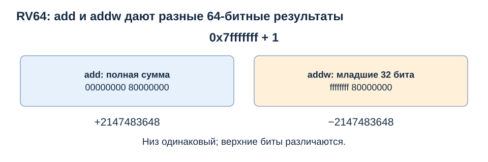

| Регистр после вычисления | Hex | Интерпретация signed RV64 |
|---|---|---:|
| t2 (`add`) | `0x0000000080000000` | 2147483648 |
| t3 (`addw`) | `0xffffffff80000000` | −2147483648 |
| t4 (расширение нулями) | `0x0000000080000000` | 2147483648 |

Чтобы убрать старшие биты t3, сдвигаем влево на 32, затем логически вправо на 32. Оба шага видны в Registers. Вариант `zext.w` — псевдоинструкция, доступность зависит от инструмента.

`mul` сохраняет младшие XLEN бит произведения. M также даёт `div`, `divu`, `rem`, `remu` (и `mulh`, `mulhu`, `mulhsu` для старшей половины произведения). Для −17 и 5 знаковое деление округляет к нулю: частное −3, остаток −2; −17 = (−3)×5 + (−2). Запустите пример до конца и проверьте t5 и t6. RARS печатает −3.

В RISC-V деление на ноль определено ISA (для `div`/`divu` частное — все единицы, остаток равен делимому); это не означает, что такая операция разрешена в C. Аналогично переполнение signed C не имеет общего определения через wraparound. В ассемблере работаем с конкретными правилами ISA.

### 5. Биты как набор независимых настроек

[Задача 4 — изменение битов](rars/04_bits.asm).

Пусть в одном числе бит 0 означает питание, бит 1 — звук, бит 2 — запись. Начальное число 5 = `101₂`. Требуется включить звук, выключить запись, переключить питание, узнать состояние звука.

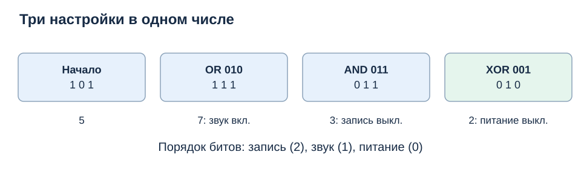

| Действие | Выражение в C | Инструкция | Результат |
|---|---|---|---|
| Включить звук | `v \| 2` | `ori t1,t0,2` | 7 (`111`) |
| Выключить запись | `v & ~4` | `andi t2,t1,-5` | 3 (`011`) |
| Переключить питание | `v ^ 1` | `xori t3,t2,1` | 2 (`010`) |
| Узнать состояние звука | `(v >> 1) & 1` | `srli` и `andi` | 1 |

Маска `~4` в RV64 состоит из единиц везде, кроме бита 2; это −5 в дополнительном коде. `andi` знаково расширяет 12-битную константу, так что маска применяется ко всем 64 битам.

Для отрицательных чисел сдвиги вправо различаются. −8 хранится как `0xfffffffffffffff8`. `srli` заполняет освободившиеся биты нулями: `0x7ffffffffffffffc`; `srai` копирует знаковый бит: `0xfffffffffffffffc`, то есть −4. Откройте t6 и a1 после сдвигов, затем сравните с таблицей. В RV64 непосредственный сдвиг на 0–63 допустим; для `*w` — 0–31. Регистровая величина сдвига маскируется по ширине операции.

### 6. Сравнение без переходов

[Задача 5 — signed и unsigned](rars/05_compare.asm).

Пока не делаем `if` и циклы: инструкции `slt`/`sltu` просто записывают 0 или 1 в регистр и переходят к следующей строке.

Один шаблон `0xffffffffffffffff` означает −1 как signed или 2^64−1 как unsigned. Сравниваем его с 1: `slt t2,t0,t1` даёт 1; `sltu t3,t0,t1` даёт 0. `slti` сравнивает с константой. `seqz` — псевдоинструкция проверки на ноль (`sltiu rd,rs,1`), `snez` — проверка ненулевого значения (`sltu rd,zero,rs`).

Проверьте t2–t6. Вопрос о том, как по результату сравнения выбрать разные участки кода, относится к следующему семинару о нелинейных инструкциях.

### 7. Практика: вычислить полином

[Задача 6 — прямое вычисление и схема Горнера](rars/06_poly.asm). В исходном конспекте эта задача записана как функция; сейчас зададим коэффициенты непосредственно инструкциями `li`, а результат посмотрим в регистре.

P(x) = a·x³ + b·x² + c·x + d. При a=2, b=3, c=4, d=5, x=2 получим 16+12+8+5=41.

Прямой вариант: сначала `x²`, потом `x³`, умножаем степени на коэффициенты и складываем. В нашем прямом варианте 5 умножений и 3 сложения (8 вычислительных инструкций, без установки входных значений). Повторно используем x².

Группируем выражение:

P(x) = x·(a·x²+b·x+c)+d = ((a·x+b)·x+c)·x+d.

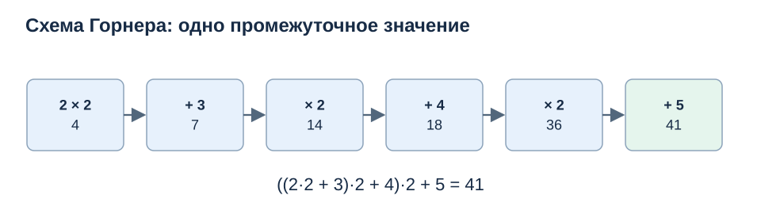

Теперь один временный регистр проходит состояния 4 → 7 → 14 → 18 → 36 → 41. Требуются 3 умножения и 3 сложения. В RARS поставьте breakpoint на первое вычисление Горнера, затем Step шесть раз. В t3 и t4 в конце должно быть 41. Меняем x на −1 (результат 2), затем на 0 (5). Для целочисленных инструкций эквивалентность сохраняется и по модулю 2^64; для signed C на переполнение рассчитывать нельзя.

## Часть 2. Кросс-компиляция и GNU Toolchain

### 8. Что именно собираем и зачем нужен Linux

RARS уже умеет переводить исходник в инструкции и выполнять их в собственном симуляторе. Но он не создаёт обычный исполняемый Linux ELF через стандартный линкер. Чтобы понять промышленный путь сборки, возьмём тот же расчёт 19+23 и соберём настоящую программу Linux RISC-V.

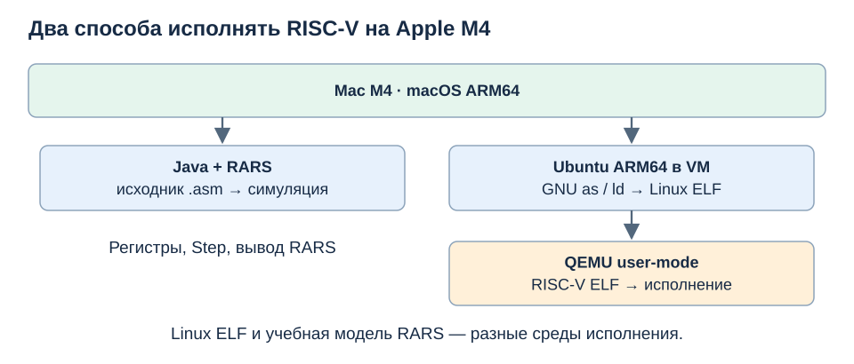

Host — среда, в которой работает инструмент; target — среда, для которой он создаёт код. У нашего `riscv64-linux-gnu-gcc` host — Linux ARM64, target — Linux RISC-V 64. Сам Mac ARM64 запускает виртуальную машину Ubuntu ARM64, а Ubuntu запускает кросс-инструменты. Установите окружение по [инструкции](docs/setup.md#2-ubuntu-arm64-на-mac-m4). Все следующие команды выполняются внутри Ubuntu из корня проекта.

Имена инструментов содержат целевую платформу: `riscv64-linux-gnu` — архитектура, ОС и GNU-окружение/ABI. В других соглашениях возможен компонент vendor (например, `riscv64-unknown-linux-gnu`); это не всегда ровно три части. `riscv64-unknown-elf` — типичный bare-metal target без Linux. 

`gcc -dumpmachine` показывает target.

| Инструмент | Назначение |
|---|---|
| `riscv64-linux-gnu-gcc` | Драйвер: компиляция C, ассемблирование, компоновка |
| `riscv64-linux-gnu-as` | Ассемблер: `.s` → `.o` |
| `riscv64-linux-gnu-ld` | Линкер: `.o` → ELF |
| `riscv64-linux-gnu-readelf` | Изучение заголовков, секций, символов, релокаций ELF |
| `riscv64-linux-gnu-objdump` | Дизассемблирование и просмотр содержимого секций |
| `qemu-riscv64` | Выполнение Linux RISC-V ELF в user-mode |
| `qemu-system-riscv64` | Эмуляция целой машины (не запускаем на семинаре) |
| `gdb-multiarch` | Отладчик для нескольких архитектур |

### 9. Первая настоящая программа на ассемблере

Откройте [linux/first.s](linux/first.s). Первые три команды совпадают с RARS. Различаются только точка входа и завершение: здесь `_start` — адрес, с которого загрузчик передаст управление; это не функция C. Шаблон Linux `a0=42; a7=93; ecall` завершает процесс с кодом 42. В RARS код сервиса печати 1; в Linux номера сервисов другие. Поэтому файл RARS нельзя просто собрать и ожидать того же вывода в Linux.

Директива `.section .note.GNU-stack,"",@progbits`
сообщает компоновщику, что данной программе не требуется исполняемый стек (executable stack). Это служебная директива, связанная с безопасностью программы в Linux. Она не является инструкцией RISC-V и не выполняется процессором.

Проводим сборку:

```bash
mkdir -p build
riscv64-linux-gnu-as -march=rv64im -mabi=lp64 -g -o build/first.o linux/first.s
file build/first.o
riscv64-linux-gnu-readelf -h build/first.o
riscv64-linux-gnu-objdump -dr -M no-aliases build/first.o
```

- `.o` — перемещаемый объектный файл ELF (тип REL), уже содержит машинный код, но пока не является полноценной программой.

- `-march=rv64im` выбирает ISA (march - machine architecture, RV = RISC-V, 64 = 64 bit registers, i = base set of integer instructions, m = extension of integer multiplication and division); 

- `-mabi=lp64` — целочисленный ABI 64-битной платформы (long and pointer are 64 bit ones). ABI - соглашение о взаимодействии скомпилированных частей программы друг с другом (размеры типов данных, передача аргументов функции, получение результата функции, использование регистров и стека)

- `-g` сохраняет отладочную информацию 

- `objdump -d` декодирует инструкции, 

- `-r` показывает релокации, 

- `-M no-aliases` показывает реальные мнемоники.

```bash
riscv64-linux-gnu-ld -e _start -o build/first build/first.o
file build/first
riscv64-linux-gnu-readelf -h build/first
riscv64-linux-gnu-readelf -A build/first
```

Линкер определяет размещение секций, разрешает ссылки на символы и записывает точку входа. 

- `-e _start` указывает вход. 

ELF теперь типа EXEC, Machine — RISC-V, Class — ELF64. 

Атрибут `Tag_RISCV_arch` отражает заявленную ISA, например `rv64i2p1_m2p0` (версии зависят от toolchain). Нет libc, динамического загрузчика и стартового C-кода: мы указали собственный `_start`.

Попробуйте:

```bash
./build/first           # на ARM64 обычно Exec format error
qemu-riscv64 build/first
echo $?                 # 42
```

Если в Linux настроен binfmt, первый запуск может автоматически вызвать QEMU, это не нативное исполнение RISC-V. Вторая команда не печатает 42: это код завершения, который оболочка хранит в `$?`. Проверяйте его сразу, поскольку следующая команда изменит `$?`.

Такую же сборку можно выполнить через драйвер GCC:

```bash
riscv64-linux-gnu-gcc -march=rv64im -mabi=lp64 -g \
    -nostdlib -static -no-pie -Wl,-e,_start linux/first.s -o build/first-gcc
qemu-riscv64 build/first-gcc
echo $?
```

- `-nostdlib` исключает стандартные стартовые файлы и библиотеки, 

- `-static -no-pie` формирует статический не-PIE исполняемый файл, 

- `-Wl,...` передаёт параметр линкеру.

### 10. QEMU: динамическая и статическая сборки C

[linux/hello.c](linux/hello.c) — готовая минимальная C-программа. Здесь не изучаем реализацию `main` на ассемблере и вызов `puts`; они нужны лишь как демонстрация использования стандартной библиотеки.

```bash
riscv64-linux-gnu-gcc -march=rv64gc -mabi=lp64d -O0 -g linux/hello.c -o build/hello
file build/hello
riscv64-linux-gnu-readelf -lW build/hello
qemu-riscv64 -L /usr/riscv64-linux-gnu build/hello
```

Ожидается `Hello, RISC-V!`. 

- `-L` задаёт префикс путей к целевому интерпретатору ELF и библиотекам. В Debian/Ubuntu они находятся под `/usr/riscv64-linux-gnu`; 

- `readelf -lW` позволяет найти `INTERP`. 

- `lp64d` используется в стандартном Linux RISC-V toolchain с ABI двойной плавающей точки, а RV64GC включает расширения, необходимые для такого окружения. Не смешивайте объектные файлы с несовместимыми ABI.

```bash
riscv64-linux-gnu-gcc -march=rv64gc -mabi=lp64d -O0 -g -static \
    linux/hello.c -o build/hello-static
qemu-riscv64 build/hello-static
ls -lh build/hello build/hello-static
```

Та же строка, но необходимые библиотечные части уже включены в статический ELF. Обычно такой файл существенно больше. `qemu-riscv64` переводит гостевые инструкции и обслуживает Linux-системные вызовы через хост Linux. Это не то же самое, что `qemu-system-riscv64`, который моделирует целую машину и требует гостевого окружения (обычно ОС, ядро и образ диска). Для задачи запуска ELF на Ubuntu user-mode проще.

Чтобы увидеть отдельные этапы GCC:

```bash
riscv64-linux-gnu-gcc -march=rv64gc -mabi=lp64d -S -O0 linux/hello.c -o build/hello.s
riscv64-linux-gnu-gcc -march=rv64gc -mabi=lp64d -c build/hello.s -o build/hello.o
riscv64-linux-gnu-gcc -march=rv64gc -mabi=lp64d build/hello.o -o build/hello-from-o
```

`-S` останавливается после компиляции в ассемблер; `-c` — после создания объекта; без этих параметров драйвер вызывает линкер. В сгенерированном коде будут функции и стековые инструкции — изучим их позднее. Здесь важно увидеть артефакты на диске.

### 11. Директивы, метки, секции — что хранится в ELF

Исследуем [linux/layout.s](linux/layout.s). Не запускаем этот файл: в нём нет инструкций процессора. Ассемблер создаёт описанные байты в секциях объектного файла. Это этап сборки, а не работа процессора с памятью.

```bash
riscv64-linux-gnu-as -march=rv64im -mabi=lp64 -o build/layout.o linux/layout.s
riscv64-linux-gnu-readelf -SW build/layout.o
riscv64-linux-gnu-readelf -sW build/layout.o
riscv64-linux-gnu-objdump -s -j .data build/layout.o
```

| Директива GNU as | Эффект |
|---|---|
| `.byte`, `.half`, `.word`, `.dword` | Помещают 1, 2, 4, 8 байт на число |
| `.float`, `.double` | Формируют IEEE 754 binary32 и binary64 |
| `.ascii`, `.asciz` / `.string` | Строка без нуля / с завершающим нулём |
| `.zero`, `.skip` | Резервируют указанное количество байт с нулевым заполнением по умолчанию |
| `.balign 8` | В GNU as выровнять по границе 8 байт; `.align 3` в RISC-V GNU as тоже означает 2³ |
| `.equ NAME, expr` | Задать значение символа (константу) |

RARS и GNU as — разные ассемблеры. Например, автоматическое выравнивание данных и поддержка директив могут различаться; для GNU примера выравнивание задано явно. `.section .rodata` и `.bss` исследуем в GNU, не переносим файл дословно в RARS. Для комментариев в файлах используем `#`.

В `.data` ожидаем байты `44 33 22 11 55 00 00 00 08 07 06 05 04 03 02 01`. RISC-V Linux little-endian: младший байт многобайтного числа располагается первым. `.balign 8` после пяти байтов добавляет три байта заполнения. `data1` — символ со смещением 0 в `.data`, `wide` — 8, `end_data` — 16; `DATA_SIZE = end_data-data1 = 16`. Метка обозначает адрес, а не содержимое. В объектном файле значения адресов могут быть смещениями, окончательные адреса определяет линкер.

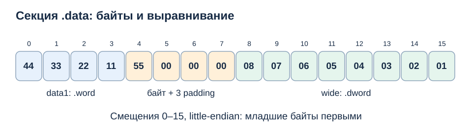

| Секция | Назначение | Типичное разрешение при загрузке |
|---|---|---|
| `.text` | Инструкции | R-X |
| `.rodata` | Неизменяемые данные | R-- (может входить в R-X сегмент) |
| `.data` | Инициализированные изменяемые данные | RW- |
| `.bss` | Нулевые данные | RW- |

Секции нужны линкеру, а загрузчик ELF руководствуется программными заголовками и сегментами `PT_LOAD`; разрешения относятся к сегментам/страницам, не непосредственно к названиям секций. Поэтому точное расположение и флаги зависят от линкера.

Сравните [data_big.s](linux/data_big.s) и [bss_big.s](linux/bss_big.s): оба объявляют 1 МиБ нулей.

```bash
make sections
```

В `.data` секция типа PROGBITS содержит байты в файле; `.bss` типа NOBITS имеет размер 1 МиБ, но не хранит 1 МиБ полезных байтов в ELF. Файлы имеют служебные заголовки и таблицы, поэтому `.bss`-объект не нулевой по размеру. Точные размеры зависят от версии инструментов, сравниваем порядок величин. При загрузке исполняемого ELF область `.bss` должна быть нулевой; ОС может выделять физические страницы лениво.

#### Символ из другого файла и релокация

В [linux/reloc.s](linux/reloc.s) директива `.dword data1` просит записать адрес метки из другого файла. Ассемблер ещё не знает этого адреса. Он формирует релокацию R_RISCV_64, а линкер вычислит окончательное значение. `.globl data1` в layout.s делает символ видимым для связывания. Обычные метки могут быть локальными; числовые локальные метки `1:`, `1f` (следующая вперёд) и `1b` (предыдущая назад) в GNU as позволяют переиспользовать номер — не ограничены соседними именованными метками.

```bash
riscv64-linux-gnu-as -march=rv64im -mabi=lp64 -o build/reloc.o linux/reloc.s
riscv64-linux-gnu-readelf -sW build/reloc.o
riscv64-linux-gnu-readelf -rW build/reloc.o
riscv64-linux-gnu-ld -e _start -o build/linked build/first.o build/layout.o build/reloc.o
riscv64-linux-gnu-readelf -sW build/linked
riscv64-linux-gnu-objdump -s -j .data build/linked
riscv64-linux-gnu-readelf -lW build/linked
```

В reloc.o символ `data1` имеет индекс UND, а relocation содержит ссылку на него. В linked найдите окончательные адреса `data1` и `data_address`; в `.data` по адресу второго символа находится little-endian представление первого. Сравните `readelf -rW build/linked`: для этого статического примера релокация разрешена. Если убрать layout.o из команды линкера, получится undefined reference. Это реальный пример связывания двух объектных файлов без единой инструкции работы с данными во время выполнения.

Разность двух меток одной секции может быть вычислена сразу (`end_data-data1`); абсолютный адрес требует релокации. Позиционно-независимый код использует относительные адреса там, где возможно; GOT и динамические релокации понадобятся в более сложных программах. Связывание функций C и ассемблера из исходного конспекта оставляем до темы ABI.

### 12. Отладка настоящего ELF через GDB

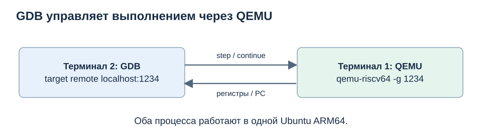

В двух терминалах **одной и той же Ubuntu** перейдите в корень проекта. В первом:

```bash
qemu-riscv64 -g 1234 build/first
```

Процесс ждёт подключения, это нормально. Во втором:

```bash
gdb-multiarch build/first
```

Внутри GDB:

```gdb
set disassemble-next-line on
target remote localhost:1234
x/6i $pc
info registers pc t0 t1 t2
si
info registers pc t0
si
info registers pc t1
si
info registers pc t2
p/x $t2
p/d $t2
continue
quit
```

После `target remote` выполнение остановлено у входа `_start`. `x/6i $pc` показывает шесть инструкций с текущего PC, `si` (stepi) выполняет одну машинную инструкцию, `p/x` печатает hex, `p/d` — decimal. После трёх шагов t2=42 (0x2a). `continue` завершает программу; GDB может показать exit code `052` (в восьмеричной записи это 42). В первом терминале `echo $?` тоже даёт 42. 

Чтобы повторить, сначала снова запустите QEMU с `-g`, затем подключитесь заново. 

Для breakpoint после подключения используйте `break *_start+8`, `continue` (при старте с `_start` остановка перед третьей 4-байтовой инструкцией), затем `si`. Адреса команд можно узнать через `disassemble _start`; для другого ELF с расширением C не предполагайте шаг адресов +4 без проверки.

### 13. Итоговое упражнение: тот же полином без RARS

[linux/poly.s](linux/poly.s) содержит вычисления из задачи 6 по схеме Горнера, но с Linux-шаблоном завершения.

```bash
make linux
riscv64-linux-gnu-objdump -d -M no-aliases build/poly
qemu-riscv64 build/poly
echo $?                 # 41
make check-linux
```

Самостоятельно измените `x=2` на `x=-1`, выполните `make linux` и проверьте код завершения 2. Верните x=2 для автоматической проверки. Теперь вы прошли весь путь: записали алгоритм в инструкциях, собрали объектный файл, получили ELF, выполнили его на другой архитектуре и проверили результат. В следующий раз сможем добавлять нелинейное управление, память и функции.

### Справочник и необязательное чтение

В [исходном конспекте](docs/original.md) есть расширенные таблицы инструкций. `sh2add`, `add.uw` — Zba; `min/max`, `rev8`, `clz/ctz/cpop`, `rol/ror`, `andn/orn/xnor` — Zbb; `bset/bclr/bext/binv` — Zbs. Они не относятся к базовому I. Посмотрите [linux/extensions.s](linux/extensions.s) и `make extensions` (нужна поддержка расширений GNU as). Это демонстрационный объект, не исполняемый файл. Основные задачи не зависят от этих расширений.

Некоторые уточнения к исходному конспекту: `subw` — отдельная инструкция, а не `addw`; `li` — псевдоинструкция, не ограничена imm12; регистры `t` не обязаны терять значение при каждом вызове — ABI лишь не гарантирует сохранность; разделы ELF и сегменты загрузки не одно и то же. Исходный файл сохранён дословно, чтобы можно было сопоставить материал с курсом.

[Спецификация ISA RISC-V](https://docs.riscv.org/reference/isa/unpriv/unpriv-index.html) · [RARS](https://github.com/TheThirdOne/rars) · [GNU assembler](https://sourceware.org/binutils/docs/as/) · [GDB](https://sourceware.org/gdb/current/onlinedocs/gdb.html)
