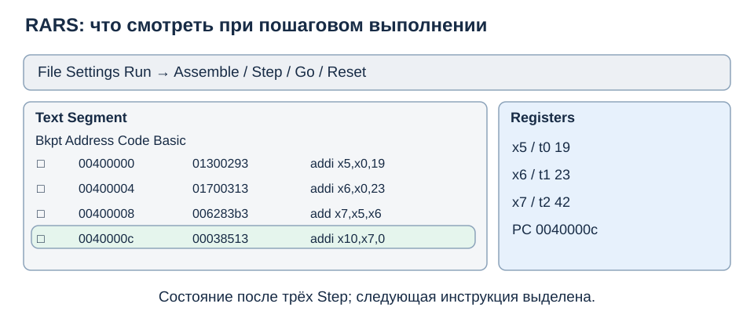

# Подготовка окружения: Mac с Apple Silicon M4

Для занятия нужны два независимых инструментария. RARS запускается непосредственно на macOS; Linux GNU Toolchain и QEMU — внутри Ubuntu ARM64. Устанавливать Linux RISC-V или x86-64 не нужно.

## 1. RARS на macOS

Откройте Terminal. Проверяем архитектуру и Java:

```bash
uname -m
java -version
```

Ожидаем `arm64` и Java 21 или выше (Java 21 требуется для указанной в конспекте сборки RARS-CU; стандартному RARS 1.6 достаточно Java 8, но используем 21 для обеих версий).

Если Homebrew уже установлен:

```bash
brew install --cask temurin@21
export JAVA_HOME=$(/usr/libexec/java_home -v 21)
export PATH="$JAVA_HOME/bin:$PATH"
java -version
```

Если `brew` отсутствует, установите его по инструкции на [brew.sh](https://brew.sh/) либо скачайте JDK 21 для macOS AArch64 с [Adoptium](https://adoptium.net/temurin/releases/?version=21). Команды `export` действуют в текущем терминале; при необходимости повторите их в новом терминале. Не устанавливайте x64-версию JDK для M4.

### Загрузка JAR

В корне распакованного проекта:

```bash
mkdir -p tools
curl -fL https://github.com/TheThirdOne/rars/releases/download/v1.6/rars1_6.jar -o tools/rars.jar
java -jar tools/rars.jar
```

Если сеть не даёт скачать файл, откройте [страницу релизов RARS](https://github.com/TheThirdOne/rars/releases/tag/v1.6), скачайте `rars1_6.jar` и положите его в `tools/rars.jar`. В архиве JAR не поставляется.

Если учебный курс выдал `rars-cu.jar`, используйте его вместо обычной сборки:

```bash
java -jar /путь/к/rars-cu.jar
```

Пути с пробелами заключайте в кавычки. Все наши программы — самостоятельные, особый режим запуска функций RARS-CU не нужен. Варианты меню и CLI в RARS-CU могут отличаться; инструкции ниже относятся к стандартному RARS 1.6.

### Первый запуск GUI

1. `File → Open` → `rars/01_first.asm` (откройте из корня проекта).
2. В `Settings` включите `RV64` (64-bit mode). Если опция запуска с глобальной метки `main` доступна, включите её; здесь `main` и так является первой инструкцией. Выключите сборку всех файлов каталога (`Assemble all files in directory`), иначе будут несколько меток `main`.
3. `Run → Assemble`. Откроется вкладка Execute. Если появились ошибки, смотрите Messages (номер строки). После каждого изменения исходника нужно снова выполнить Assemble.
4. Найдите Text Segment: `Address` — адрес машинной инструкции, `Code` — её 32-битный код, `Basic` — реальная инструкция, `Source` — исходная строка. В Registers найдите x5/t0, x6/t1, x7/t2 и PC. Включите шестнадцатеричное отображение для примеров с битами; для простых чисел можно убрать его.
5. `Run → Step` три раза. После первой инструкции `t0=19`, после второй `t1=23`, после третьей `t2=42`. PC указывает на следующую инструкцию; подсветка интерфейса может выделять следующую, а не только что исполненную строку.
6. `Run → Reset` сбрасывает состояние собранной программы. Установите флажок Bkpt напротив `add t2,t0,t1` в Text Segment и выполните `Run → Go`. Остановимся **перед** сложением; затем Step выполняет сложение. Снимите точку останова, Go до конца. В Run I/O появится `42`.
7. Измените `23` на `30`, сохраните, Assemble и Go. Результат `49`. Верните исходное значение.



Это учебная схема, не снимок экрана: расположение элементов может различаться между выпусками RARS. Названия команд приведены для обычного RARS. Если клавиши F-клавиатуры macOS перехватываются системой, пользуйтесь меню, а не горячими клавишами.

### Терминальный режим RARS

```bash
java -jar tools/rars.jar h
java -jar tools/rars.jar nc rv64 sm rars/01_first.asm
java -jar tools/rars.jar nc rv64 sm hex t0 t1 t2 rars/01_first.asm
make check-rars
```

`nc` убирает баннер, `rv64` выбирает RV64, `sm` начинает с глобальной `main`, `hex` выбирает шестнадцатеричный формат; `t0 t1 t2` запрашивают вывод конечных значений регистров. Для сборки без выполнения добавьте `a`. Скрипт проверяет шесть ответов, в том числе отрицательное частное. Вывод PrintInt (сервис 1) в RARS RV64 использует младшие 32 бита как знаковое число: широкие значения смотрим в Registers, а не через PrintInt.

Ссылки: [RARS](https://github.com/TheThirdOne/rars), [CLI](https://github.com/TheThirdOne/rars/wiki/Using-the-command-line), [Environment calls](https://github.com/TheThirdOne/rars/wiki/Environment-Calls).

## 2. Ubuntu ARM64 на Mac M4

Если есть рабочая Ubuntu ARM64 в Lima или UTM, используйте её: создание новой машины необязательно. Для Lima на Mac:

```bash
brew install lima
limactl start --name=riscv-course --vm-type=vz template:ubuntu-24.04
limactl shell riscv-course
```

Если версия Lima не понимает `template:ubuntu-24.04`, посмотрите `limactl start --help` и используйте `template:ubuntu` (в старых версиях `template://ubuntu`). `vz` — виртуализация средствами Apple. Внутри Ubuntu:

```bash
uname -m     # aarch64: архитектура гостевой системы
cat /etc/os-release
sudo apt update
sudo apt install -y build-essential file gcc-riscv64-linux-gnu \
    binutils-riscv64-linux-gnu libc6-dev-riscv64-cross \
    qemu-user qemu-system-riscv gdb-multiarch
```

Проверка:

```bash
riscv64-linux-gnu-gcc --version
riscv64-linux-gnu-gcc -dumpmachine
riscv64-linux-gnu-as --version
riscv64-linux-gnu-ld --version
qemu-riscv64 --version
qemu-system-riscv64 --version
gdb-multiarch --version
```

`qemu-system-riscv64` устанавливаем для знакомства с составом инструментов, но на этих занятиях используем только `qemu-riscv64`. Для user-mode гостевая ОС RISC-V не нужна. `qemu-user` на Ubuntu ARM64 работает как ARM64-программа, переводя инструкции RISC-V.

### Перенос проекта в Linux

Lima по умолчанию монтирует домашнюю папку macOS на чтение. Пусть проект распакован на Mac в `~/Downloads/riscv-seminars`. В Ubuntu выполните:

```bash
mkdir -p ~/course-work
cp -R /Users/ВАШ_ЛОГИН/Downloads/riscv-seminars ~/course-work/
cd ~/course-work/riscv-seminars
pwd
ls
make linux
make check-linux
```

Замените `ВАШ_ЛОГИН` на имя пользователя macOS (на Mac его можно получить командой `whoami`). Копия в гостевой домашней папке доступна для записи. Не запускайте сборку в каталоге `/Users/...`, если он смонтирован read-only. Для UTM можно перенести ZIP через SCP или общую папку и распаковать внутри Ubuntu. Важно: `build/` создаётся в Linux, JAR для этого не требуется.

При следующем запуске Mac: `limactl start riscv-course` (если остановлена), `limactl shell riscv-course`. Для завершения: выйдите из shell (`exit`), на Mac выполните `limactl stop riscv-course`.

Официальная документация [Lima: использование](https://lima-vm.io/docs/usage/) и [QEMU user-mode](https://www.qemu.org/docs/master/user/main.html).

## 3. Типичные проблемы

| Симптом | Причина и действие |
|---|---|
| `UnsupportedClassVersionError` | JDK слишком старый: `java -version`, `JAVA_HOME` и PATH как выше. |
| `Unable to access jarfile` | Неверный путь или JAR не скачан: `ls -l tools/rars.jar`. |
| Ошибка на `addw` | В RARS включить RV64, пересобрать. |
| Duplicate label `main` | Выключить сборку всего каталога RARS. |
| `command not found: riscv64-linux-gnu-gcc` | Команда должна выполняться в Ubuntu после установки пакетов. |
| `Read-only file system` | Скопировать проект в домашнюю папку Linux. |
| `Exec format error` | ARM64 не выполняет RISC-V ELF напрямую; запустить через QEMU. Если binfmt настроен, прямой запуск может автоматически вызвать QEMU. |
| `Could not open '/lib/ld-linux-riscv64-lp64d.so.1'` | Для динамической программы указать `qemu-riscv64 -L /usr/riscv64-linux-gnu ...` либо использовать статическую сборку. |
| GDB не подключается | QEMU с `-g 1234` запущен первым и ожидает, оба терминала в одной Ubuntu, порт не занят. |
